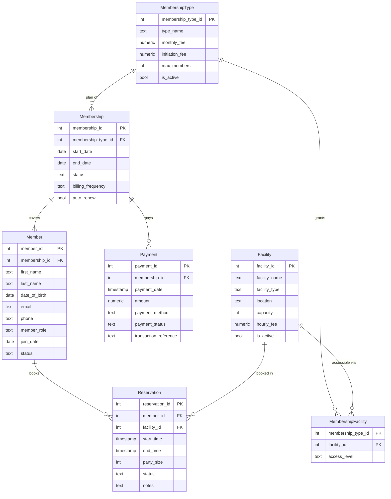

# Country Club Natural-Language SQL Interface

## Purpose of the database
A country-club management database (SQLite, 7 tables) that tracks membership plans, purchased memberships,
the people on each membership, payments, facilities (golf, pool, tennis, fitness, dining), which plans may use
which facilities, and facility reservations. A web app lets anyone ask questions in plain English; GPT writes
the SQL, the app runs it, and GPT turns the rows back into a friendly answer.

Schema spec: [schema_details.md](schema_details.md) · SQL: [schema.sql](schema.sql) · Fake data: [data.sql](data.sql)
(generated by [generate_data.py](generate_data.py): 5 plans, 43 memberships, 88 members, 225 payments, 10 facilities, 90 reservations).

## Schema picture

(Renders on GitHub / VS Code Markdown preview. You can also paste [schema.sql](schema.sql) into drawsql.app or supabase for a picture.)

## Run it
```powershell
cd C:\Users\grpas\OneDrive\Desktop\cs452-natural_lang
pip install -r requirements.txt
# .env must contain:  OPENAI_API_KEY=sk-...   (it is git-ignored; never share it)
python generate_data.py      # optional: regenerates data.sql (already included)
python app.py                # builds countryclub.sqlite and serves http://localhost:8081
python run_experiments.py    # optional: runs 10 questions x 3 strategies -> EXAMPLES.md (~$0.005)
```
Then open **http://localhost:8081**.

**Cost:** uses `gpt-4.1-nano` (OpenAI's cheapest chat model, $0.10 / $0.40 per 1M tokens in/out), temperature 0.
Each question costs about $0.0001-0.0002 (shown under every answer). Override with env var `OPENAI_MODEL`.
The SQL is executed on a **read-only** connection and only a single `SELECT`/`WITH` is allowed.

## Questions to try
- How many active memberships are there for each membership type?
- Which membership type has generated the most completed payment revenue?
- Who has the most reservations, and how many?
- Which memberships have a failed payment?
- What is the average party size for tennis reservations?
- Which members have no email address on file?
- Which active memberships have auto-renew turned off?
- How much has each payment method brought in (completed payments only)?
- Which facilities are inactive, and do any have reservations?
- What are the names and ages of all children on Family memberships?

## Sample question that WORKED
**Q:** Who has the most reservations, and how many?  
**SQL (all three strategies agreed):** a `Member JOIN Reservation GROUP BY member ... ORDER BY COUNT(*) DESC LIMIT 1` query  
**Result:** a single row with the member and count; GPT replied with a one-sentence friendly answer.
(Exact SQL/rows are in [EXAMPLES.md](EXAMPLES.md).)

Another: *"Which membership type has generated the most completed payment revenue?"* - correct joins
`Payment → Membership → MembershipType`, filtered `payment_status = 'Completed'`, in every strategy.

## Sample question that did NOT work
**Q:** *Which facilities can Student members access and at what access level?*  
- `zero_shot` produced `JOIN ... mf.access_level` without ever joining `MembershipFacility` → `OperationalError: no such column: mf.access_level`.
- `single_domain_double_shot` joined `Facility.facility_id = MembershipType.membership_type_id` (comparing unrelated ids) → empty result → "No matching data was found".
- `multi_domain_double_shot` wrote deeply nested subqueries and also returned nothing.

The correct SQL is a simple 3-table join:
```sql
SELECT f.facility_name, mf.access_level
FROM MembershipType mt
JOIN MembershipFacility mf ON mf.membership_type_id = mt.membership_type_id
JOIN Facility f ON f.facility_id = mf.facility_id
WHERE mt.type_name = 'Student';
```
Lesson: the junction table (M:N) is where the cheap model struggles most.

**Silent wrong answer:** *"Which members have reserved a facility their membership type has no access to?"* - the model
returned members whose access was `'Restricted'` (a row that exists) rather than members with **no** `MembershipFacility` row
(needs `NOT EXISTS`). The friendly answer confidently said "her membership type does not have access" - it was wrong.
Also *"List the Family memberships and how many members each one covers"* returned per-plan totals (zero/multi-domain) or 43 rows
including non-family plans (single-domain) instead of filtering `type_name = 'Family'` and grouping per membership.

## More examples
See [EXAMPLES.md](EXAMPLES.md) (10 questions × 3 strategies, with SQL, rows and answers) and the raw
[results/experiments.json](results/experiments.json).

## Prompting strategies tried (paper: arXiv 2305.11853)
| Strategy | What the prompt contains |
|---|---|
| `zero_shot` | Schema (CREATE TABLE) + dialect notes + "only respond with sqlite" + question |
| `single_domain_double_shot` | Same + one worked Q→SQL example from *this* database |
| `multi_domain_double_shot` | Same + one worked Q→SQL example from a *different* database (vet clinic) |

Observations (10 questions, `gpt-4.1-nano`; see the table at the top of [EXAMPLES.md](EXAMPLES.md)):
- Counts/aggregates over 1-2 joins worked in all strategies; differences were small with this tiny model.
- Zero-shot was the only one to produce a *syntax-level* error (missing join) on the junction-table question, while the
  few-shot variants instead produced valid-but-wrong SQL (silent failures, which are worse).
- A same-domain example sometimes biased the model toward copying the example's shape (e.g. `Member`-centric queries),
  hurting the "Family memberships" question; the cross-domain example didn't help much either.
- Success without an SQL error: zero-shot 9/10, single-domain 10/10, multi-domain 10/10 - but "no error" is not "correct"
  (see the silent wrong answers above), so check the SQL shown in the UI.
- Dialect notes in the prompt (booleans are 1/0, today's date, "revenue = Completed") kept time/revenue questions sensible
  (I did not A/B test removing them). Giving the friendly-answer step the SQL and columns (not just raw tuples) made answers clearer.
- Takeaway: with this tiny model, examples reduced hard errors but not logic mistakes; a bigger model would likely fix the join mistakes.
